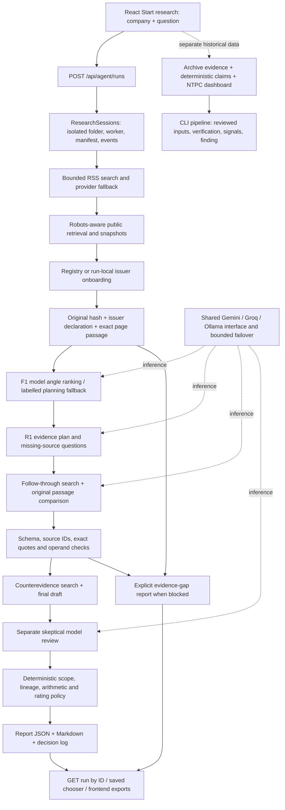

# SignalForge: audited feature cheat sheet

Audit date: 25 October 2026, Asia/Kolkata. Team: Arshia Dang, Ashwera Hasan, Samaira Sharma. This is the source of truth for the accompanying demo script, Q&A and quick reference.

## Audit boundary, repository and verdict

**CONDITIONAL GO.** A real company-to-reviewed-report workflow completed on the final integrated code. It produced issuer-backed observations and a correct calculation, but no independently corroborated novel financial discovery. Present research discipline and traceability; do not promise a red flag for the judges' company.

Audited runtime code: integration commit `df71552` on `codex/arshia-demo-readiness`, combining the three Arshia commits through `48f909f` with remote `main` commit `e19b9de9ad081c685ba9a3e7a64a062cf9f710f7`. The latter added deduplication, planning-lead display, truthful failed-stage records and topic-sensitive search recovery. Seven merge conflicts were resolved by preserving both implementations; an upstream test fixture was corrected to construct a real session before testing its active-run guard. Subsequent audit deliverables are documentation/artifact changes, not a research-algorithm rewrite. The integrated branch was pushed; `main` was not overwritten. Use `git log -1 --format='%H %s'` for the documentation delivery commit and `git merge-base --is-ancestor e19b9de HEAD` to confirm integration.

**Late upstream change deliberately excluded from today's demo:** during the final consistency check, `origin/main` advanced to `8630a67b55b9948352ab50a2ed41c9ff5331dfd4`, adding xAI Responses and different configuration/recovery semantics across22 files. That implementation exists on GitHub, not in this pinned demo branch. Its own `XAI_MIGRATION_REPORT.md` reports failed model-list authentication (HTTP400 API-key error), no generation, no verified model access and no completed Grok investigation. Those are upstream-reported results, not tests performed on this Mac. Integrating a new provider migration after the successful smoke test would create a different unverified demo version, contrary to the audit-first scope. The tested branch therefore includes `e19b9de` but not `8630a67`; it must not be force-pushed or casually merged over `main`. The37-feature inventory below describes the actual pinned runtime; the upstream-only xAI integration is outside it and is not a demonstrated provider. Validate credentials, reconcile both branches' provider settings and rerun suites/smoke before a future migration.

Current machine: Apple M2, 8 GB RAM, Python 3.14.3, Node 24.21.0. Backend is the local Python HTTP service at port 8765; frontend is React 19, TypeScript and Vite 6 at port 5173. Ollama is unavailable here. The upstream `signalforge/DEMO_HANDOVER.md` describes a different 16 GB/local-model session; its installed-model assertions do not apply to this Mac.

### Verification performed on the integrated code

| Check | Exact command/path | Observed result |
|---|---|---|
| Backend suite | `PYTHONPATH=signalforge/src .venv/bin/python -m unittest discover -s signalforge/tests` | **359 run: 357 passed, 2 skipped**; 11.577 seconds on final passing run |
| Skips | `tests/test_pdf_table_extraction.py` original-PDF cases | Required original annual-report PDF absent; fixture/integration tests still run. These two original-file checks are not runtime proof |
| Frontend | In `signalforge/web`: `npm test` | **44 passed**, four test files |
| TypeScript | `npx tsc -b` | Passed |
| Production assets | `npm run build` | Passed; Vite 6.4.4; no build warnings observed |
| Whitespace | `git diff --check` | Passed |
| Hosted inference | `PYTHONPATH=signalforge/src .venv/bin/python -m signalforge.provider_health --all --probe` | Groq 120B JSON 0.660 s; Gemini flash-lite JSON 1.072 s; Ollama connection failure |
| API via Vite proxy | GET health, run list, final run ID | HTTP200; invalid ID HTTP404 |
| Historical assets | GET evidence, claims, finding bundle | HTTP200. Global F1/readiness outputs HTTP404; UI explains missing optional outputs |
| Browser | Actual start, polling, report, quote drilldown, archive filters, saved reports and exports | Exercised. See UI inventory and fresh smoke run below |

The new live smoke test was initiated with **Start research** in the actual browser: `research_20261025T051452_b844776593ba`. It completed in **94.743607 seconds**, without manual recovery, a Coal India catalog or a supplied PDF. The initial RSS searches had zero accepted results; onboarding navigated the issuer site using an unverified model URL hint and fetched the original report. This establishes that navigation fallback worked for this company, not that RSS discovery worked or every unfamiliar company is covered.

## Actual architecture and connected paths

The backend is `research_service.handler/main`, not FastAPI. Endpoints are GET `/api/agent/health`, GET/POST `/api/agent/runs`, and GET `/api/agent/runs/<run_id>`. It binds loopback, checks Host/Origin, bounds JSON requests and rejects duplicate active work in that service. Health reports configuration/process status with `not_probed`; it does not contact the models. Vite's `localResearchData` middleware exposes read-only `/api/research/<key>` files and proxies `/api/agent` to Python. `vite preview` alone does not provide this complete development-server middleware/proxy workflow.

The SPA has five state/hash views, not five backend page routes. `StartResearch` appears above every view. `ResearchSessions.execute` connects onboarding, F1, R1 and `run_investigation`; the standalone R1 CLI remains plan-only. Archive claim extraction, PDF-native tables, the reviewed-input `pipeline.py`, `capacity_timeline.compare_project`, and dossier authoring are CLI/library paths; starting live research does not automatically execute all of them.

## Feature inventory: exactly one primary status per feature

WORKING means observed through its intended path; it does not mean perfect financial truth. PARTIALLY WORKING means meaningful limitations remain. BROKEN means attempted and failed here. NOT TESTED means no adequate runtime verification. NOT IMPLEMENTED means absent. Counts: **15 WORKING, 17 PARTIALLY WORKING, 1 BROKEN, 1 NOT TESTED, 3 NOT IMPLEMENTED = 37 features.**

| ID | Feature | Primary status | Evidence / demo impact |
|---|---|---|---|
| F01 | Company/question entry and session orchestration | WORKING | Fresh browser smoke; run-local manifest, stages and terminal report |
| F02 | Local API, proxy and process health | WORKING | HTTP200/404 checks, service tests, actual UI POST/polling |
| F03 | Generic issuer onboarding | PARTIALLY WORKING | Coal India acquired online; identity is issuer self-declaration; coverage not universal |
| F04 | Wrong-company and identity conflict gates | WORKING | Runtime rejection logs plus onboarding/discovery adversarial tests |
| F05 | Public search discovery | PARTIALLY WORKING | Executes, but all seven fresh-run searches yielded zero accepted results |
| F06 | Zero-result penalized lead fallback | PARTIALLY WORKING | Tests and Hindalco logs; leads are not verified evidence; fresh smoke retained none |
| F07 | Public document retrieval | PARTIALLY WORKING | Issuer PDF fetched; robots, 403, redirects and accessibility can block |
| F08 | Local document parsing | PARTIALLY WORKING | PDF/CSV/text/HTML paths; flattened tables and image-only pages remain difficult |
| F09 | Automatic OCR | NOT IMPLEMENTED | Empty/image pages need another original or manual/OCR intake outside live flow |
| F10 | Provenance, immutable originals and deduplication | WORKING | Hash rechecks; same-URL/content tests; no URL-count corroboration |
| F11 | Machine evidence eligibility | WORKING | 16 fresh Coal India records; hash/issuer/page checks; separate from semantic truth |
| F12 | Human evidence-review workflow | PARTIALLY WORKING | Approval metadata gate exists; no end-user approval-writing UI |
| F13 | Model F1 angle ranking | PARTIALLY WORKING | Fresh F1 validated after one schema repair; only one candidate, not broad hypothesis coverage |
| F14 | Deterministic F1 planning fallback | WORKING | Hindalco actual fallback provenance and focused tests |
| F15 | R1 research planning | WORKING | Fresh two-step plan; evidence allowlist and next-stage handoff |
| F16 | Autonomous investigation execution | PARTIALLY WORKING | Fresh complete reviewed run plus recovered cases; not reliable for all companies |
| F17 | Exact citations and bounded repair | WORKING | 14-character regression, live longer-quote probe and actual completed repairs |
| F18 | Live investigation calculations | PARTIALLY WORKING | Fresh 200/300 ratio checked; units/scope largely model-reviewed, not a universal reconciliation engine |
| F19 | Reviewed-input signals and milestone helpers | WORKING | Legacy pipeline run, unit/basis tests, Decimal milestone helper tests |
| F20 | Independent corroboration | PARTIALLY WORKING | Conservative lineage/claim checks; none established for complete Coal India cases |
| F21 | Counterevidence acquisition | PARTIALLY WORKING | Real searches; fresh run found no new supporting document |
| F22 | Skeptical semantic review | PARTIALLY WORKING | Fresh review completed; earlier review missed a duplicated sum |
| F23 | Scope, deadlines and falsification | PARTIALLY WORKING | Absence/deadline guards work; generated falsification can still be weak |
| F24 | Evidence grading and no-finding classification | WORKING | Live Weak/Not rated outcomes; policies exposed; uncalibrated rubric |
| F25 | Reports, saved runs and exports | WORKING | JSON/Markdown/browser/persistence verified |
| F26 | Recovery and stage audit | WORKING | Actual resumed citation case; changed search topics now require a new search checkpoint |
| F27 | Shared inference and automatic failover | PARTIALLY WORKING | Actual Ollama→Groq success and transport tests; every route not live-proven |
| F28 | Groq inference | PARTIALLY WORKING | Fresh JSON and prior F1/R1; account 8K TPM, 413/429 observed |
| F29 | Gemini inference | PARTIALLY WORKING | Fresh complete run and JSON; intermittent 503 observed |
| F30 | Ollama on this Mac | BROKEN | No reachable service/model; current health probe failed |
| F31 | Archive ingestion and structured claim extraction | WORKING | Existing outputs, golden fixtures and backend tests; candidate claims remain unverified |
| F32 | Cross-chunk and PDF-native tables | PARTIALLY WORKING | Fixture/integration tests pass; original-file tests skipped; not live automatic intake |
| F33 | Historical NTPC charts/dossier/dashboard | WORKING | Browser formulas, source inputs, dossier and downloads; explicitly a prior run |
| F34 | Archive browse/filter/research-angle panels | WORKING | Browser tabs, ID search, filters and provenance checked; important scope limits below |
| F35 | OpenAI cloud provider route | NOT TESTED | Generic SDK route exists; no dedicated account/live call tested |
| F36 | Automatic current NIFTY/sector eligibility | NOT IMPLEMENTED | No constituent refresh/validation service in the live path |
| F37 | Systematic novelty/market-knowledge evaluation | NOT IMPLEMENTED | Model flag exists; no independently evaluated market-knowledge corpus or benchmark |

### F01–F02: entry, sessions and API

**F01 — WORKING.** Plain English: turn a company and question into a saved investigation. Financial purpose: keep each issuer/question's evidence separate. Technically, `StartResearch.start` posts only `{company,prompt}`; `ResearchSessions.start/_work/_save` allocates a UUID directory, starts a worker and appends events while atomically replacing the manifest. React polls about every 1.5 seconds and hides a previous report during recovery. Inputs are two strings; outputs are run state and report, not an instant answer. Evidence: fresh smoke and `test_research_service.py`. Say: “This is the actual job and run ID.” Avoid: “The displayed historical NTPC panel belongs to this new company.” Full functionality would add robust cross-process job locking and cancellation; one service instance is the supported demo setup.

**F02 — WORKING.** Plain English: local frontend talks to a local worker safely. Financial purpose: prevent accidental path/file or issuer substitutions through arbitrary caller inputs. `research_service.handler` checks Host/Origin, content type, request size and run-ID syntax; Vite proxies live requests and serves allowlisted archive files. It is a local prototype without login, remote tenancy or deployment infrastructure. Evidence: service tests and actual API200/404/browser calls. Say: “The health endpoint reports runtime configuration; the probe performs inference.” Avoid: “Health200 proves the financial agent works.” Use the documented loopback development server; hosted multiuser deployment would require separate engineering.

### F03–F04: issuer identity

**F03 — PARTIALLY WORKING.** Plain English: acquire an original annual report for a company outside the registry. Financial purpose: reduce wrong-issuer research. `company_onboarding.onboard/candidate_pdf_urls/read_identity` combines existing snapshots, optional operator files, Wikidata/URL hints and issuer-page navigation under a 150-second cooperative budget; it pins an original PDF and writes a run-local registry. It prefers a labelled equity ISIN and can separately accept a labelled CIN; neither a search result nor a model URL is evidence. Inputs are legal name and reachable documents; output is issuer identity, source hash and audit. Fresh Coal India used CIN on physical page67 and online issuer navigation, with no prepared catalog. Say: “Source-declared identity, with any external conflict recorded.” Avoid: “Exchange-authenticated/current NIFTY eligibility.” More authoritative mappings and issuer coverage are needed; a labelled operator-supplied original is an honest fallback.

**F04 — WORKING.** Plain English: stop other companies' documents being accepted just because search returned them. Financial purpose: avoid attributing subsidiary, peer or national statistics to the issuer. `source_discovery.company_relevance/result_relevance`, `read_identity`, machine-evidence checks and issuer-text checks constrain intake; an external ISIN conflict stops onboarding. Candidate rejection and tests include wrong issuers and spoofed domain suffixes. This is conservative pattern/source checking, not universal document authentication. Say: “Rejected hits remain audit records.” Avoid: “A company name appearing anywhere authenticates the document.” Preserve blocks and obtain a correctly identified original when necessary.

### F05–F09: acquisition and parsing

**F05 — PARTIALLY WORKING.** Plain English: search public material for the company and question. Financial purpose: seek relevant disclosures rather than rely solely on a prepared annual report. `source_discovery.discover/build_queries/BingRSSSearch` limits queries/results/fetches/time, filters company/topic, ranks URLs and records provider attempts; DDG/Gemini search implementations also exist, but live sessions choose Bing RSS. In the fresh run, initial3, follow-through2 and opposition2 searches retained zero results; issuer navigation supplied the PDF separately. Say: “The search attempted these queries and found no usable hit.” Avoid: “A search action proves broad web coverage.” A stronger search backend and authoritative indexes are future work; use the explicit saved report during judging.

**F06 — PARTIALLY WORKING.** Plain English: reconsider a few safe near-miss leads after zero strict results. Financial purpose: improve recall without pretending a lead is verified. `borderline_leads/inspect_lead_content` retain at most three unique candidates with a 35-point penalty and reasons, then inspect retrieved content; normal issuer/evidence checks still apply. Tests and the historical Hindalco run exercise this lane; the fresh run retained no borderline lead. Say: “Lower relevance is disclosed; evidence eligibility is a separate gate.” Avoid: “Penalized relevance is financial confidence.” Better candidate retrieval is needed; never relax issuer checks to make a report appear complete.

**F07 — PARTIALLY WORKING.** Plain English: download reachable public originals and keep the bytes. Financial purpose: make evidence auditable after the model runs. `public_sources.retrieve_urls`, the legacy `source_retrieval.execute`, and onboarding's snapshot-only option enforce bounded downloads, robots policy and redirect checks, returning status/path/hash metadata. The fresh issuer PDF was acquired online; robots failures, inaccessible originals and previous403s remain real. Say: “This is the retrieved original and its hash.” Avoid: “All public sites are accessible.” Use another permitted original or a clearly labelled supplied/cached file; never bypass access controls.

**F08 — PARTIALLY WORKING.** Plain English: extract text while preserving page/source identity. Financial purpose: trace a number back to a location. `evidence_ingestion`, `document_text_ingestion`, `source_catalog.read_pages` and `pypdf` handle different formats; page-marker CSV dumps use a dedicated parser rather than ordinary table loading. Outputs preserve raw text, normalized records, parse status and warnings, while flattened multi-column text can lose associations. Say: “A locator proves where text came from, not that table meaning survived.” Avoid: “PDF parsing is lossless.” Inspect the original layout or use an appropriate table path when meaning is ambiguous.

**F09 — NOT IMPLEMENTED.** Plain English: automatic recovery of text from scanned pages is absent. Financial purpose: inaccessible text can hide critical disclosures, so the agent must expose the gap. The live path uses text extraction and flags unusable pages; no OCR service follows those flags automatically. No output can be claimed for a scan without usable text. Say: “We need an accessible original or a separately reviewed OCR intake.” Avoid: “We read every PDF.” Implement and evaluate OCR/layout recovery before claiming this capability.

### F10–F12: evidence integrity and review

**F10 — WORKING.** Plain English: preserve origin and avoid counting copies repeatedly. Financial purpose: five URLs must not become five independent witnesses. Snapshot SHA-256, passage/record IDs, physical pages, `collect_sources` deduplication by hash/URL/normalized content and immutable model audits connect outputs to original bytes. Original rehashes passed for all final fresh-run quotations; deduplication tests passed after integration. Say: “A hash detects changes; it does not certify the publisher's truth.” Avoid: “A different domain is independent corroboration.” Full provenance still needs trustworthy publisher and derivation attribution; inspect source lineage when uncertain.

**F11 — WORKING.** Plain English: admit eligible text to F1 only after mechanical checks. Financial purpose: prevent a wrong or altered file becoming a model's company evidence. `machine_evidence.create_machine_evidence/machine_evidence_eligible` checks original hash, issuer declaration, literal page span and substantive text, then `eligible_ingested_evidence` enforces schema, identity and parsing. Fresh onboarding yielded16 eligible records, with claims still unverified. Say: “Automatically cross-checked is a source-eligibility state.” Avoid: “Machine eligibility verifies the financial conclusion.” Human/semantic claim review remains separate.

**F12 — PARTIALLY WORKING.** Plain English: approved human evidence and machine-checked evidence are distinct lanes. Financial purpose: never fabricate an analyst's sign-off. F1 accepts valid approval metadata or valid machine checks; generic ingestion defaults to pending review and does not write an approval. The archive UI browses review states but has no functioning approve/reject mutation workflow. Say: “No human approval has been invented.” Avoid: clicking “Claim review” and calling that a completed human audit. A real approval UI and reviewer identity/audit policy would complete this feature; for today use the existing machine lane honestly.

### F13–F17: selecting, planning and investigating

**F13 — PARTIALLY WORKING.** Plain English: propose and rank evidence-led research angles. Financial purpose: spend effort on a potentially material, testable question. `f1_research_angle_selector.run`, its prompt and schema supply evidence and five weights: financial significance30%, evidence availability25%, testability20%, non-obviousness7.5%, cross-validation17.5%; code recomputes weighted arithmetic without changing the model's score inputs. Fresh F1 needed one array-type schema repair and returned one reliable candidate, so that run does not demonstrate broad multi-hypothesis comparison. Say: “This run selected one angle; other recorded replays returned more.” Avoid: “The ranking is calibrated alpha prediction.” More diverse evidence and benchmarked selection would improve it; preserve unreliable-output labels.

**F14 — WORKING.** Plain English: create a usable investigation plan when F1 cannot rank reliably. Financial purpose: keep missing market-data joins from erasing genuine company disclosures. `deterministic_angle_fallback` matches eligible evidence against the three contest-angle keyword rules, applies the published fixed scores and records its reason/IDs/method in `f1_fallback.json`. Hindalco used this real fallback, while the fresh Coal India run used model ranking. Say: “This is deterministic research planning, not a model ranking or verified signal.” Avoid claiming the fallback discovers financial facts. Tests and provenance are the workaround for model unreliability; better ranking quality remains future work.

**F15 — WORKING.** Plain English: turn the chosen angle into concrete evidence questions. Financial purpose: specify what would confirm or refute the hypothesis. `r1_research_investigator.run/load_evidence_ids/validate_plan` validates the company/candidate, permits only supplied eligible IDs and forbids pretending planned lookups already have sources. Fresh R1 produced two checklist steps; the research service then invokes the executor. Say: “R1 is the plan; the following executor does retrieval.” Avoid: “The standalone R1 module autonomously completes research.” Broader follow-through coverage is an executor limitation, not fabricated R1 evidence.

**F16 — PARTIALLY WORKING.** Plain English: follow the plan to a reviewed report. Financial purpose: distinguish proposed research from accepted observations. `investigation.run_investigation/collect_sources/draft_result` searches, chooses bounded original passages, drafts claims, searches opposition, drafts again and requests skeptical review. The fresh run completed all stages in94.74s without manual recovery; historical runs stopped or required recovery. Say: “This complete execution still ended inconclusive.” Avoid: “It succeeds on any company” or “completed means novel discovery.” Use the verified saved case if the live job is slow; more source coverage and model reliability are still needed.

**F17 — WORKING.** Plain English: reject quotes the model cannot point to exactly. Financial purpose: prevent attractive wording or a number from becoming invented evidence. `check_citation/norm/quote_catalog/resolve_quote_references` enforce supplied IDs, contiguous spans and a15-character normalized minimum; typographic/whitespace normalization is allowed, changed figures and stitched text are not. The original14-character `68.5% Complete` really matched but was misdiagnosed; tests, precise feedback, bounded repair and a live longer JCRL quotation now verify the correction. `structured_generation.generate_validated` keeps rejected raw attempts and allows one repair. Say: “Exactness is necessary, not proof of entailment.” Avoid: “Every failed quote is fabricated.” Preserve valid observations while fixing/withholding the failing optional calculation; do not weaken matching.

### F18–F24: arithmetic, opposition and assessment

**F18 — PARTIALLY WORKING.** Plain English: calculate with source-backed operands. Financial purpose: a fluent model must not invent a denominator or count one project twice. Live `calculate` uses `Decimal` for difference/ratio/sum and exact dates for days, checks quoted numbers, rejects zero division and repeated identical sum operands, and requires model review of the basis. Fresh Khavda200/300 gave66.66666666666666666666666667%; the older68.5/100 and1600+1600 attempts were withheld. Say: “This is a project completion ratio, not financial loss.” Avoid: “The live layer automatically reconciles every period/unit/ownership scope.” The legacy signal engine has richer explicit compatibility checks; do not imply that all are wired into live inference.

**F19 — WORKING.** Plain English: compute transparent signals from reviewed inputs and comparable milestones. Financial purpose: avoid mismatched denominators, reporting boundaries and event definitions. `signals.ratio_signal/composition_signal/growth_signal/target_coverage_signal` checks unit conversions, status/basis/date compatibility and rounding; `pipeline.verify_inputs` connects source verification to these inputs. `capacity_timeline.compare_project` requires the same project/unit/capacity/milestone and `exact_share` uses Decimal; these are library/CLI helpers, not an automatic project-history service. The historical NTPC pipeline and current signal/milestone tests exercise them. Say: “The dashboard preserves direct-table versus derived-residual distinctions.” Avoid treating a capacity share as economic ownership or revenue. Wider reviewed inputs and schedule revisions remain necessary.

**F20 — PARTIALLY WORKING.** Plain English: ask whether separate origins support the same claim. Financial purpose: prevent an issuer's repeated narrative from masquerading as confirmation. `classify_independence` supplies hints only; live `collect_sources/adjudicate` requires attributed lineage and claim-level reviewer support, while legacy `assess_independence` collapses hashes, publishers and derivations. All complete Coal India cases are issuer-only; a prepared NTPC dossier contains regulator counterevidence, which is a different claim/context. Say: “None is established for this finding.” Avoid: “Government hosting makes an issuer submission independent.” Acquire matched, dated regulator/operator records and attribute original authorship before upgrading confidence.

**F21 — PARTIALLY WORKING.** Plain English: actively search for facts that could defeat the hypothesis. Financial purpose: avoid a one-sided investment story. The executor issues follow-through and opposition searches, retains attempted queries/failures, and can add new snapshots before final drafting. The fresh run performed both two-query searches but found no accepted document; recovered old searches must match the topic or a new suffixed stage is created. Say: “Counter-search ran; it did not obtain independent counterevidence.” Avoid: “No search result proves no opposing evidence exists.” Show the audit and state missing inputs; improve authoritative retrieval later.

**F22 — PARTIALLY WORKING.** Plain English: a second model pass challenges the proposed meaning. Financial purpose: catch a true number attached to the wrong entity, date or conclusion. `REVIEW_SCHEMA`, the skeptical review prompt and `adjudicate` check all claim IDs, conclusion support, independence, calculation basis and counterargument handling. Fresh review passed; an earlier review missed a duplicate calculation, which code now rejects. Say: “A separate pass, not a separate independent witness or human audit.” Avoid claiming semantic guarantees. Use deterministic checks and analyst review alongside the model; more adversarial evaluations are needed.

**F23 — PARTIALLY WORKING.** Plain English: limit what an excerpt and a milestone can establish. Financial purpose: a future target cannot automatically be called a missed deadline. `adjudicate` downgrades heuristic document-wide absence claims and replaces certain award-only falsification criteria; `capacity_timeline` rejects mismatched milestones. Actual earlier Coal India nondisclosure assertions were downgraded, but the fresh model's9.5GW/early-project falsification wording is too broad to be a definitive schedule test, and its planning lead pairs a renewable hypothesis with a rail quotation. Say: “These are analyst-refinement prompts; the accepted observations have their own citations.” Avoid presenting generated leads, causes or falsification as established causal evidence. Match the same project, valid deadline, revisions and cutoff before asserting slippage; this audit did not rewrite the algorithms.

**F24 — WORKING.** Plain English: communicate evidence sufficiency separately from a model's opinion. Financial purpose: stop a thin case being sold as a strong signal. Live `adjudicate` returns Moderate only when the key conclusion passes, at least one key claim is independently corroborated, and the alternative is addressed; otherwise Weak, with Strong deliberately unavailable to automated review. `evidence_gap_report` uses Not rated and no accepted claims; old persisted Hindalco/early Coal India gap reports still show their historical Weak rating. Legacy `findings.evidence_strength` separately permits Strong only with confirmed primary key inputs, independent confirming groups, cross-checks and complete computations; its ranking rubric is explicitly provisional. Say: “Relevance, F1 priority, claim support and evidence strength are different.” Avoid calling any of them calibrated probability.

### F25–F30: output, recovery and providers

**F25 — WORKING.** Plain English: reopen and export exactly what a run produced. Financial purpose: let another analyst inspect the reasoning and sources. `write_report`, `InvestigationView`, `investigationMarkdown` and `ResearchSessions.get/list_runs` expose report JSON/Markdown, source passages, chronology, assumptions, decision log and actual run IDs. Browser downloads wrap JSON as `{run_id,investigation}`; both types are distinct from the separate historical dashboard's Download report controls. Saved selection persists in origin-local storage and is disabled while that tab's run is active. Say: “This is an explicitly saved completed example.” Avoid presenting a cached report as the current assigned company's result. Prepare a second tab before starting live research; no cancellation UI exists.

**F26 — WORKING.** Plain English: continue a stopped case without erasing its earlier work. Financial purpose: preserve auditability through provider or validation failures. `resume_run.resume` snapshots prior artifacts, revalidates F1/R1, rehashes originals and reuses successful stages; `draft_result` sends a rejected draft and exact error into bounded repair and can withhold an invalid optional duplicate sum before fresh review. The citation run's eight cached input hashes stayed unchanged and final recovery took30.559s; topic-sensitive search recovery now prevents labelling an old different query as newly executed. Say: “Recovery is a CLI operation; the UI observes its saved state.” Avoid: “Every failed stage resumes automatically” or treating cross-process locking as robust production scheduling. Inspect the owning process before resume.

**F27 — PARTIALLY WORKING.** Plain English: share one validated output contract across model providers. Financial purpose: changing providers must not change what counts as evidence. `llm_client.routes/generate_json/_generate_once` uses dedicated credentials, ordered unique routes, zero SDK retries, bounded requests and one short directed Groq quota wait; schema/quote failures go through bounded content repair, not transport failover. Provider/model/latency/usage/status and fallback reasons are collected into model audits and manifests. Actual unavailable-Ollama→Groq success and focused failure/exhaustion tests exist, but not every provider transition has succeeded live. Say: “Transport fallback preserves validation gates.” Avoid: “Fallback guarantees research completion.” Manual provider override plus resume is the documented alternative.

**F28 — PARTIALLY WORKING.** Plain English: fast hosted inference through Groq's compatible endpoint. Financial purpose: obtain usable F1/R1 when another provider is unavailable. The dedicated `GROQ_API_KEY`, `openai/gpt-oss-120b`/20B routes, low reasoning effort, bounded completion size and schema-format adapter are implemented in the shared client. Current120B JSON took0.660s; earlier real F1/R1 worked, but this account produced8K-TPM413/429 failures on large/rapid requests. Say: “A backup for appropriately bounded requests.” Avoid equating context-window size with account throughput or minimal-probe latency with full-run duration. Wait for quota or use the tested larger-context Gemini path; do not repeatedly resubmit.

**F29 — PARTIALLY WORKING.** Plain English: hosted Gemini inference for the full investigation context. Financial purpose: keep more original passages available for review. The compatible SDK uses `gemini-3.1-flash-lite` with `SIGNALFORGE_API_KEY`; URL hints and inference are separately audited. The current JSON probe took1.072s and the fresh full run94.74s, but earlier503 availability failures were real. **Recommended today on this Mac: Gemini for the full live demonstration**, with an explicitly saved report and manual Groq/resume contingency. Avoid a guarantee of latency or future availability; minimal probes do not establish financial correctness.

**F30 — BROKEN here.** Plain English: local inference needs a running Ollama service and installed model. Financial purpose: a tested local route could reduce hosted-provider dependency, but that premise is absent on this8GB Mac. `local_model_status` and the current provider probe failed to connect; no local F1/R1 inference was demonstrated here. The upstream16GB session reports an8B smoke success and420s full timeout; current code bounds local request timeout to at most120s, so that old number is historical. Say: “The adapter exists; local inference is unavailable on our demonstration machine.” Avoid claiming installed weights or quota-free end-to-end success. Use hosted inference today; install/benchmark locally later.

### F31–F37: archive tools, interface limits and absent capabilities

**F31 — WORKING.** Plain English: turn preserved document text into reviewable structured candidates. Financial purpose: retain value, unit, date, entity and context rather than lose them in a summary. `document_text_ingestion`, `claim_extraction.extract_claims/run_extraction` and `dataset_audit` use deterministic parsing, schema checks and stable provenance; extraction status is separate from verification status. The archive has8,241 evidence records and the displayed prose store4,423 candidates; the separate full table-aware pipeline loaded40,942 claims, so these counts describe different stores. The parser's exchange-ID patterns include NTPC-specific archive rules; do not advertise that parser as universal issuer onboarding. Say: “Candidates require review.” Avoid presenting extracted numbers as verified facts. Wider issuer/table fixtures and original-source checks would extend coverage.

**F32 — PARTIALLY WORKING.** Plain English: recover table meaning from row/header and PDF layout context. Financial purpose: prevent a figure being assigned the wrong year, unit or ownership column. `table_extraction` handles single/cross-chunk context under conservative ambiguity rules; `pdf_table_extraction` uses optional PyMuPDF layout, page coordinates and tie-outs, producing additive claims for CLI integration. Current fixtures/integration tests pass, but two original-PDF checks skip and the live onboarding path does not automatically run PDF-native extraction. Say: “An experimental CLI capability with tested fixtures.” Avoid: “All live tables are structurally reconstructed.” Obtain the original PDF/dependency and verify layout before using that path in a new demonstration.

**F33 — WORKING.** Plain English: inspect the prepared NTPC portfolio example and counterexample dossier. Financial purpose: show denominator, group/parent boundary and direct-versus-derived figures transparently. `signal.tsx`, `finding.ts`, public finding assets, `demo_dossier` and legacy pipeline outputs drive cards, ratio tables, trace disclosures, source inputs, opposing evidence and exports. The browser labels it **SAVED PRIOR RUN · NTPC · Separate from live research above**; it remains provisional/Weak and contains operator-prepared inputs. Say: “This is the historical verification interface.” Avoid calling it live Coal India output, commissioned capacity, economic ownership or proof of novelty. Keep it as reserve material rather than the main fresh-run story.

**F34 — WORKING as a read-only archive browser.** Plain English: inspect historical records and filter their provenance. Financial purpose: expose ambiguity instead of hiding extraction failures. `ui.tsx` implements Signal, Overview, Claim review, Evidence library and Research angles, using read-only Vite resources and local view/hash state; ID/type/verification/document/date filtering and the details-close action worked. The Research angles screen is a static archive/readiness panel that can still say **Ranking refused** while a live report above has completed F1, and the Research analyst avatar has no action handler. Say: “This panel belongs to the saved workspace; the run record above is authoritative for live stages.” Avoid treating archive counts, that refusal banner, or the workspace-company dropdown as current-run research state. A unified run-scoped interface would improve clarity; it is not required for this controlled presentation.

**F35 — NOT TESTED.** Plain English: an OpenAI-compatible route exists beyond the three tested providers. Financial purpose: a future route could support continuity but is not evidence of working research today. The generic SDK path accepts `provider=openai`; dedicated credentials, model choice and live behavior were not established here, and an OpenAI fallback is deliberately refused without explicit configuration. No actual OpenAI cloud request was made. Say: “Compatibility route, not a demonstrated integration.” Avoid listing it as a working provider. Configure and test it separately before presenting it.

**F36 — NOT IMPLEMENTED.** Plain English: the application does not automatically certify current NIFTY50/sector eligibility. Financial purpose: eligibility determines whether an otherwise valid investigation answers the contest assignment. No live constituent-feed refresh or dated membership gate appears in orchestration; a CIN/ISIN is an identity token, not an index-membership proof. The company/question must be confirmed against the judges' assignment and an authoritative dated list. Say: “We accept the assigned company; eligibility is an external prerequisite.” Avoid promising coverage of every eligible constituent. Implement/test a membership service later.

**F37 — NOT IMPLEMENTED as systematic novelty evaluation.** Plain English: no benchmark establishes that an observation is new to the market. Financial purpose: a true public fact is not automatically an investment discovery. The reviewer emits `novelty_established`, but no systematic market-knowledge corpus, prior-disclosure comparison or novelty metric is connected; all complete audited cases say false. This is not a measured alpha/recommendation engine. Say: “We have completed investigations, not a proven novel independently corroborated discovery.” Avoid invented benchmark scores or claims of market-beating signals. Build dated prior-knowledge comparisons and independently reviewed evaluations before upgrading that claim.

## Existing run audit

All run dates/times below originate from UTC manifests; local event date may be25 October in India. A `completed` manifest can mean a terminal gap report or historical plan-only completion, not successful model review. Missing durations are not inferred as active execution time.

Question keys: **Q1** = investigate announced production/capacity versus commissioned operations or material relationships; compare periods and seek independent evidence/counterarguments (exact text in each manifest). **Q2** = NTPC renewable capacity/project execution/financial significance. **Q3** = North Karanpura Unit3 matched capacity, expected/trial/COD milestones at FY2024-25 cutoff. **Q4** = Power Grid announced transmission investment versus commissioned assets. **Q5** = Hindalco renewable/project-commissioning gap with independent regulator/operator comparison.

| Run ID | Company / question | Saved outcome and model | Inputs / F1 / R1 / review | Demo use |
|---|---|---|---|---|
| `research_20261025T052701_82374d097e79` | NTPC / Q2 | Completed; inconclusive/Weak; Gemini; **103.840092s** |4 explicitly cached catalog sources;16 eligible; F1 one candidate; R1 two steps; final review complete;2 issuer claims,9.81pp capex-share difference, no claim independently corroborated | Additional recorded run that appeared during the audit, not another audit-initiated smoke test; cached acquisition must be disclosed |
| `research_20261025T052640_7b196a1b0265` | Power Grid / “what major changes have occured in this company” | Terminal gap; inconclusive/Not rated; Gemini;3.649159s |0 eligible; no F1/R1/model review; cached candidate attempts rejected | Additional no-evidence refusal; exact failed subcheck not established by the generic ValueError log |
| `research_20261025T052304_b578c6cb991b` | Power Grid / capacity divergence | Terminal gap; inconclusive/Not rated; Gemini;5.266644s |0 eligible; no F1/R1/model review | Additional no-evidence refusal |
| `research_20261025T051452_b844776593ba` | Coal India / Q1 | Fresh completed; inconclusive/Weak; Gemini flash-lite; **94.743607s** | Online issuer PDF;16 eligible; F1 one reliable candidate after schema repair; R1 two steps; final review completed | **A: best complete demo. B: best catalog-free acquisition/execution example** |
| `research_20261025T000129_2ecbfd3ad81c` | Coal India / Q1 | Recovered completed; inconclusive/Weak; Gemini final recovery | One issuer PDF;16 eligible; F1 one candidate; R1 five steps; fresh final review. Final resume30.559s; three recoveries101.650s, not a cold-run benchmark | Citation/duplicate-number repair defence; three issuer observations, no accepted calculation |
| `research_20261024T234754_a378b8365612` | Coal India / Q1 | Fresh terminal gap; inconclusive/Not rated; Groq120B with configured fallback; **172.719s** wall span | One issuer PDF;16 eligible; F1 one candidate; R1 five steps; final operand validation refused; review absent | **C: best refusal example**; invented zero not accepted |
| `research_20261024T232238_39445100e7e3` | Coal India / Q1 | Recovered complete; inconclusive/Weak; mixed Groq/Gemini | One issuer PDF;16 eligible; F1 one candidate; R1 five steps; review completed; broad absence claim unresolved | Earlier recovery example; four recoveries, do not use created-to-finished span as model latency |
| `research_20261024T232121_c7b0d4c03049` | Coal India / Q1 | Terminal onboarding gap; historical Weak; Groq20B | No eligible record, F1/R1/review absent | Intake-failure history only |
| `research_20261024T231716_0847e66a85c0` | Coal India / Q1 | Terminal onboarding gap; historical Weak; Gemini | No eligible record, F1/R1/review absent | Intake-failure history only |
| `research_20261024T210811_fa86eb3121a1` | Hindalco / Q5 | Remote finalized gap; historical Weak; Ollama8B final attempt | Cached/operator PDF;16 eligible; deterministic F1 fallback three angles; model R1 four steps;3 selected sources including unresolved parent-company pages; no final review/accepted claims | Cached-source/fallback example. Original PDF paths from another machine are absent here |
| `research_20261024T192139_d803119ec6b1` | NTPC / Q3 | Blocked at F1; Gemini |8 eligible; one unreliable candidate; no R1/review/report | Refusal of unreliable recommendation |
| `research_20261024T191230_017819901424` | NTPC / Q2 | Failed at R1; Gemini |8 eligible; F1 one reliable candidate; no validated R1/review/report | Historical planning failure |
| `research_20261024T191100_8236306745e4` | NTPC / Q2 | Historical completed planning; Gemini;50.299s wall span |8 eligible; F1 one candidate; R1 two steps; no final investigation | Never present as complete discovery |
| `research_20261024T182946_403b0d7ccfe4` | NTPC / Q2 | Historical completed planning; Gemini;76.157s wall span |8 eligible from labelled pinned source; F1/R1 done; no final review/report | Earlier F1/R1 integration only |
| `research_20261024T182719_98221b1b2fec` | NTPC / Q2 | Machine-evidence block; Gemini |0 eligible; no F1/R1/report | Historical evidence refusal |
| `research_20261024T181230_84a3bde559cc` | NTPC / Q2 | Machine-evidence block; Gemini |0 eligible; no F1/R1/report | Historical evidence refusal |
| `research_20261024T181053_848bb50d11b7` | Power Grid / Q4 | Machine-evidence block; Gemini;42.305s wall span |0 eligible; no F1/R1/report | Second-company attempt did not complete |
| `research_20261024T180705_dfbbc440c8cc` | NTPC / capacity divergence | Machine-evidence block; Gemini |0 eligible; no F1/R1/report | Historical block |
| `research_20261024T180549_f3adeaa64622` | NTPC / Q2 | Machine-evidence block; model unspecified |0 eligible; no F1/R1/report | Historical browser-start block |
| `research_20261024T180517_dc5f89f0606c` | NTPC / annual-report primary-PDF query | Machine-evidence block; model unspecified |0 eligible; no F1/R1/report | Historical CLI/search block |

### Best complete case: accepted observations, rejected inferences and sources

Fresh run `research_20261025T051452_b844776593ba` uses issuer report URL `https://www.coalindia.in/documents/14122/CIL_AR_2025-26.pdf`; original SHA-256 `6be29201be42be17fc57231e6b01eb6fab805b81d6110cc452787251af192685`. It is the same report content seen previously, newly acquired through this run's navigation. No source independence is added by a second download.

Accepted issuer observations:200MW of300MW Khavda capacity commissioned as of15 July2026;9.5GW renewable capacity is a FY2029-30 target;100MW Banaskantha plant operationalization is stated as of31 March2026. The report's calculation uses the first observation's200/300 operands and the same project/date, giving66.6666…%. It does not establish schedule lateness, lost revenue, investment value, or completion of the entire renewable program. All three reviewer independence flags are false.

Initial, follow-through and opposition searches retained zero strict or borderline hits; their3+2+2 queries are recorded. The annual report came through onboarding navigation, not successful RSS retrieval. F1's first response used a string where `data_risks_and_limitations` required an array; one bounded repair succeeded. Initial draft, final draft and fresh skeptical review each passed on their first generated response. The source hashes, all accepted quotations and the reported ratio were independently recomputed locally during this audit.

Counterargument: milestone/target dates and grid/land/supply conditions could explain apparent differences. The latter causes are hypotheses, not established project-specific causes. The generated falsification criterion and the rail quotation attached to a renewable planning lead are weaker than a proper matched-project schedule test; do not make them the central evidentiary claim. The final outcome correctly remains inconclusive/Weak and novelty=false.

### Other usable artifacts and portability

The historical dashboard uses `data/runs/run_20261024_ntpc_recovered` plus direct-table ratio/dossier assets, not the live agent run store. Its six deterministic calculations are preserved, inputs remain partly supported, and its headline5.0%/95.0% capacity split uses a different denominator than the parent renewable-intensity4.7% comparison. An OERC order in the prepared dossier supplies a counterexample to a simplistic underdelivery story; this does not independently corroborate the Coal India result. Synthetic/sample runs and `--simulate-llm` outputs are test scaffolding, not real discovery evidence.

Three more manifests appeared during this audit and are included above without claiming the auditor initiated them. The newer NTPC run selected an annual report, COD/trial filings and OERC order from existing catalogs; an independently authored source being present did not independently support either accepted claim. It reported a60GW target and a combined renewable/hydro/FGD/energy-conservation capex category; the summary's shorter renewable/hydro phrasing should not be mistaken for a clean renewable-only spending measure. Two Power Grid runs returned no-claim Not-rated gap reports. These reinforce the distinction between cached source execution and generic online source eligibility. The machine-evidence logs retain generic ValueError types for rejected cached candidates, so a more precise causal diagnosis is not established here.

Complete raw run directories and original PDFs are mostly local/ignored. Small proof exports are committed under `data/demo_validation/`, but the saved-run chooser reads actual `data/research_runs/` manifests, not those portable copies. A fresh clone needs the desired original run folder/source files to reproduce the same chooser entries and revalidation. Hindalco's old absolute PDF path is not present on this Mac; its stored report can be displayed but its evidence cannot be revalidated here. Original quote CSV, CSV archive and portions of normalized data are tracked; Node dependencies/build outputs/credentials remain local.

## UI/control audit and exact demo boundaries

| Visible control or section | Actual behavior | Caveat / safe presentation |
|---|---|---|
| Company text field + Research question + Start research | Real POST, isolated worker, disabled form during execution, actual stage polling | The supplied question is a handover example; judges' exact wording must replace it |
| Saved investigations | GET exact run; origin-local persistence; final report renderer | Disabled during that tab's active run. Prepare a separate saved-report tab before starting |
| Models used in this run / Run execution record | Details disclose calls, validation/provider outcomes and events | A provider response is not a validated conclusion |
| Claims and model challenge / Source passage buttons | Actual report citations open selected source passages, hash, locator and origin | Quote exactness does not establish external truth or semantic completeness |
| Source register and passages | Expandable original source/passage records and source URL | Some historical URLs/dates absent; local paths are not public links |
| Calculations | Current run's formula/result/input evidence | Fresh ratio valid; never reuse unrelated NTPC numbers for this company |
| Counterargument / What would falsify this assessment | Model proposal plus some deterministic guards | Causes and falsification language still need analyst refinement |
| Export investigation JSON / Markdown | Current report; JSON wrapper includes run_id and investigation | Separate from historical Download report controls |
| Saved workspace company | Selects the historical registry/workspace scope | Does not start or change the live company job |
| Signal | Live panel followed by labelled historical NTPC dashboard | Explicitly announce any switch to saved historical data |
| Overview / Open claim review | Archive counts, warnings, sample claims and navigation | Not a current-run overview |
| Claim review / search / Extraction state / source buttons | Read-only archive filter and source navigation | No approve/reject mutation or analyst sign-off |
| Evidence library / Search evidence / Type / Verification / Document / Date contains / Close evidence details | Tested ID lookup, filtering, empty result, source details and closing | First100 matches displayed; archive source, not Coal India's run store |
| Research angles | Fixed rubric and historical readiness panel | May say Ranking refused despite successful live F1 above; explain the separate scopes |
| Historical dashboard Trace, ratio/input disclosures, source links, dossier and downloads | Expand actual saved formula/input/dossier data | Provisional/Weak, operator-prepared; avoid promoting it to current discovery |
| Research analyst avatar | Cosmetic button, no action handler | Do not demonstrate as login/profile/review workflow |

For the timed demo, keep live tab `http://127.0.0.1:5173/` and backup tab `http://localhost:5173/`. Different origins have separate saved-selection storage; both use the same backend. The audit successfully viewed a complete saved report in the second tab while the fresh job ran in the first. Never start research twice. Keep the backup tab loaded and do not refresh it into the other tab's selected active job.

## What is actually innovative about SignalForge?

The defensible contribution is the integration of finance-specific evidence boundaries with a recoverable investigation workflow: stable claim/source identities; candidate-versus-verified separation; numerical operands and exact spans; explicit target/operational and parent/group distinctions; skeptical review; deterministic rejection; and persisted provider/stage audits. The duplicated-project calculation is a concrete example: a model reviewer approved it, but the later arithmetic-integrity guard refused to count the same observation twice while keeping valid facts.

Schemas, hashes, React, API workers, compatible SDK calls, retries and model review are standard engineering patterns, not inventions. Structured table interpretation and financial provenance can be valuable engineering here, but this repository provides no literature review, novelty proof, general accuracy benchmark or established market alpha. Claim “an auditable research prototype combining these controls,” not “a novel reasoning algorithm” or “a proven autonomous analyst.”

## Known weaknesses and how to defend them honestly

| Weakness | Judge-ready answer | Next meaningful action |
|---|---|---|
| Search scarcity | “Search ran, but no result passed. The report came through issuer navigation, and the absence of hits remains visible.” | Better authoritative search/index coverage |
| Independent corroboration absent | “We verified issuer statements and have not independently confirmed the operating facts.” | Matched regulator/operator COD and schedule records |
| Rejected quotation | “The exact short span failed our minimum-context rule; we fixed the diagnosis and tested a longer original span, preserving the rule.” | Continue context/entailment evaluation |
| Model latency/quota/503 | “A fresh full run took94.74s here; availability varies. The saved report is labelled, and failed stages retain audits.” | Preflight current provider and retain backup |
| Inconclusive report | “We completed the investigation without establishing the proposed material discrepancy. That is different from a failed model review.” | Obtain missing independent, comparable evidence |
| Company generalization | “Coal India worked online; Hindalco used an operator PDF; Power Grid stopped. Universal coverage is unproven.” | Holdout-company evaluation by acquisition and review stage |
| Weak leads/falsification | “Those are planning prompts, not accepted facts. A schedule claim needs the same project, milestone, cutoff and valid revised deadline.” | Human refinement plus adversarial test cases |
| Static/historical panels | “The current-run report is above; the archive panels are separate data stores.” | Unify run-scoped navigation later |
| Confidence not calibrated | “The labels are transparent policy grades, not probabilities or investment recommendations.” | Independently labelled evaluation and calibration |

### Evidence pointers

Code lives under `signalforge/src/signalforge/`; UI under `signalforge/web/src/`. Tests named in the feature cards live in `signalforge/tests/` unless explicitly frontend tests. Fresh smoke artifacts: `signalforge/data/research_runs/research_20261025T051452_b844776593ba/`. Citation recovery portable proofs: `signalforge/data/demo_validation/coalindia_citation_fix_20261025/`. Earlier validation bundle: `signalforge/data/demo_validation/arshia_20261025/`. Final audit proof exports: `signalforge/data/demo_validation/final_audit_20261025/`. The corresponding four root Markdown documents are the presentation materials; this cheat sheet is the comprehensive audit, not a spoken script.
